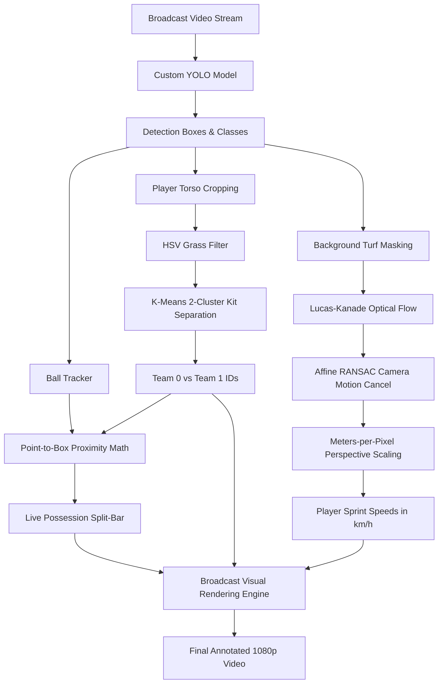

# ⚽ AI Football Vision & Analytics Engine

[](https://www.python.org/)
[](https://github.com/ultralytics/ultralytics)
[](https://pytorch.org/)
[](https://opencv.org/)
[](LICENSE)

An end-to-end computer vision and sports analytics pipeline that transforms raw broadcast match footage into live TV-style tactical telemetry. Powered by a custom-trained **YOLO architecture (97.6% mAP@50)**, **K-Means kit clustering**, **optical flow camera motion compensation**, and **real-time possession tracking**.

---

## 🌟 Key Features

* **Custom-Trained YOLO Architecture:** Fine-tuned over 80 epochs for multi-class detection (Ball, Players, Goalkeepers, Referees).
* **Unsupervised Team Kit Clustering:** Dynamically extracts jersey fabric colors via torso cropping and green pitch HSV masking, separating opposing teams with 2-cluster **K-Means** and **Exponential Moving Average (EMA)** temporal smoothing.
* **Camera Motion Compensation (Affine RANSAC):** Cancels out broadcast camera pans, tilts, and zooms using background **Lucas-Kanade Optical Flow** to accurately measure true physical player speeds (km/h).
* **Live Ball Possession Telemetry:** Employs geometric point-to-AABB clamping distance to track ball-to-shoe proximity in real time, rendering a dynamic split-bar television graphic.
* **Persistent Multi-Object Tracking (IoU):** Tracks individual player trajectories across consecutive frames with occlusion tolerance.
* **Broadcast-Style Visual Overlays:** Replaces generic bounding boxes with EA Sports FC / FIFA style floating team triangles, glowing referee ellipses, and speed telemetry badges.

---

## 🏗️ Architecture & Pipeline



---

## 📊 Model Performance

| Metric | Score | Details |
| :--- | :--- | :--- |
| **mAP@50** | **97.6%** | High-confidence spatial bounding box localization |
| **Precision** | **97.3%** | Eliminates false-positive ball & referee detections |
| **Recall** | **90.9%** | Retains tracking under heavy player occlusions |
| **mAP@50-95** | **76.7%** | Strict IoU evaluation |
| **Inference Resolution** | **640px – 1024px** | Multi-scale inference capability |
| **Training Epochs** | **80 Epochs** | Mosaic augmentations & bounding box regression |

---

## 📁 Repository Structure

```text
├── custom_markers.py    # Broadcast overlays, HSV jersey extraction, K-Means & possession bar
├── id_tracker.py        # Multi-object tracking (IoU greedy matching & track lifecycle)
├── speed_tracker.py     # Optical flow camera motion compensation & km/h speed calculation
├── index.py             # Main inference, detection, and tracking pipeline
├── play.py              # Zero-lag real-time broadcast player with controls
├── custom_model.pt      # Custom trained YOLO weights
├── media/               # Raw match video footage
├── output/              # Annotated videos and demo clips
├── requirements.txt     # Python dependencies
└── README.md            # Project documentation
```

---

## 🚀 Getting Started

### 1. Prerequisites
Ensure you have Python 3.10 or higher installed.

### 2. Clone the Repository
```bash
git clone https://github.com/viswapriyan33/football_detection.git
cd football_detection
```

### 3. Create & Activate Virtual Environment
* **Windows (PowerShell):**
  ```powershell
  python -m venv .venv
  .\.venv\Scripts\Activate.ps1
  ```
* **macOS / Linux:**
  ```bash
  python3 -m venv .venv
  source .venv/bin/activate
  ```

### 4. Install Dependencies
```bash
pip install -r requirements.txt
```

---

## 🎮 How to Run

### Run the AI Pipeline on Match Footage:
Process match footage with live tracking:
```bash
python index.py --source media/match_derby.mp4 --stream
```

#### Optional CLI Flags:
* `--source`: Path to input video, image, or webcam (e.g., `media/match_red_white.mp4`).
* `--imgsz`: Inference resolution (default `640` for speed, `1024` for max accuracy).
* `--vid_stride`: Frame step (e.g., `2` for real-time broadcast tempo).
* `--conf`: Confidence threshold (default `0.25`).

---

### Run the Smooth Real-Time Player:
To watch or screen-record pre-rendered match footage at **100% smooth, natural 25–30 FPS**:

```bash
# Play Match 2 (Navy Blue vs. White Kits)
python play.py 2

# Play Match 1 (Red vs. White Kits)
python play.py 1
```

* **Keyboard Controls:**
  * `f` &rarr; Toggle Fullscreen
  * `Spacebar` &rarr; Pause / Resume
  * `q` &rarr; Exit player

---

## 🛠️ Tech Stack & Mathematical Foundations

* **Deep Learning:** [Ultralytics YOLO](https://github.com/ultralytics/ultralytics) + [PyTorch](https://pytorch.org/)
* **Computer Vision:** [OpenCV](https://opencv.org/) (Lucas-Kanade Optical Flow, Affine Transformations, HSV color segmentation)
* **Clustering & Tracking:** Scikit-Learn / SciPy / NumPy (K-Means, IoU greedy matching, Exponential Moving Average)
* **Camera Stabilization:** Point-to-AABB distance geometry & RANSAC transformation matrices

---

## 📜 License

This project is licensed under the MIT License - see the [LICENSE](LICENSE) file for details.
